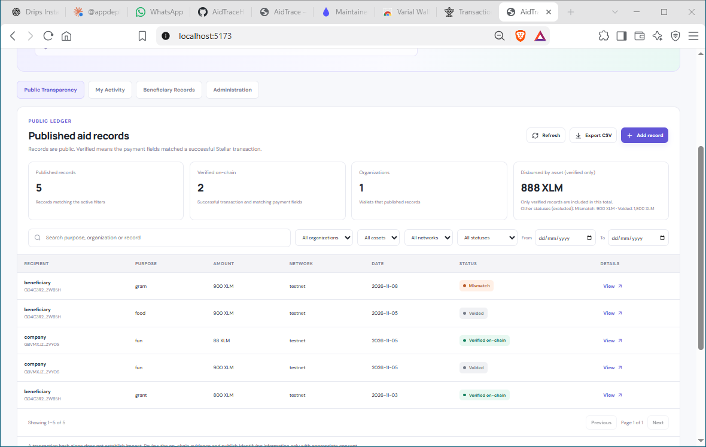
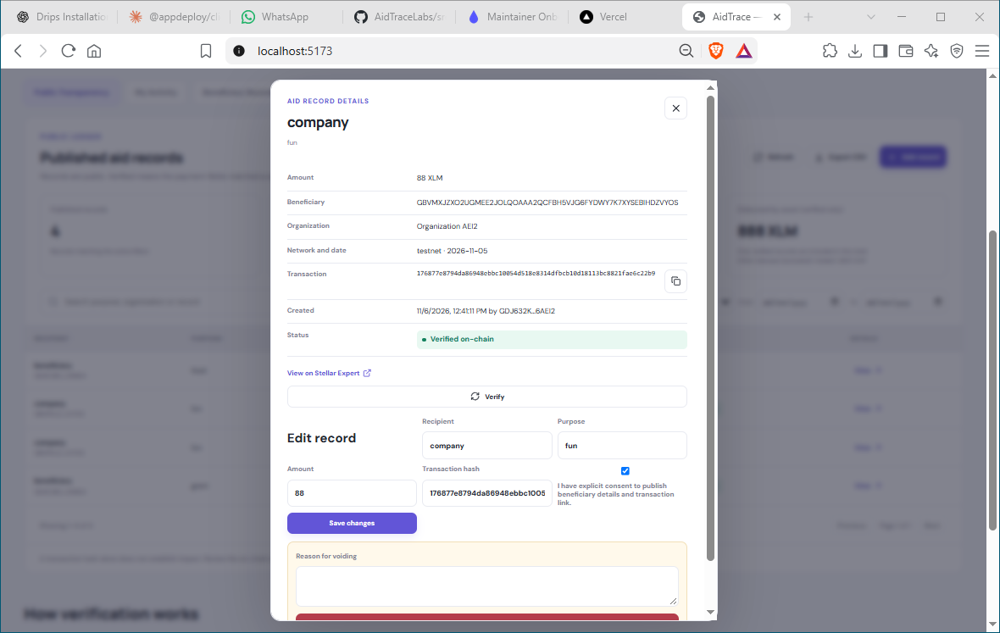
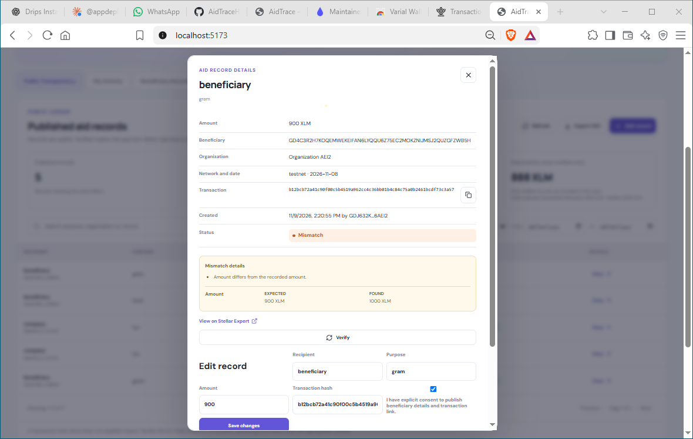
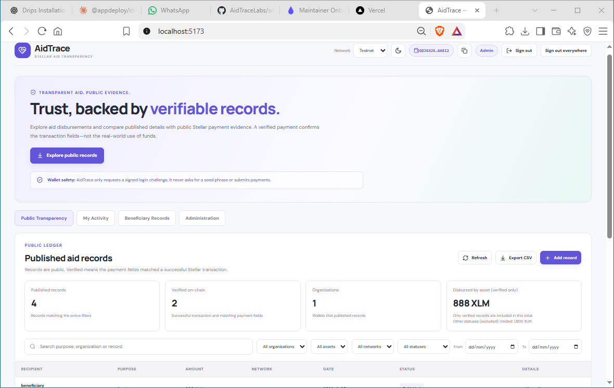
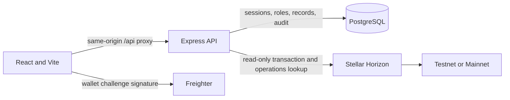

# AidTrace

AidTrace publishes aid disbursement records and compares their payment fields with public Stellar transaction data.

**Live demo:** [AidTrace demo](https://aidtrace-demo.vercel.app) (`DEMO_URL=https://aidtrace-demo.vercel.app`).

[](LICENSE)


[](https://github.com/AidTraceHQ/AidTraceLabs/actions/workflows/ci.yml)

## Why

Aid organizations and reviewers need a way to compare a published disbursement record with payment evidence without treating a transaction hash as proof of a real-world outcome. AidTrace checks transaction success and compares an individual payment operation with the record's organization wallet, recipient wallet, amount, asset, and issuer.

**What “verified” means:** the selected Stellar network returned a successful transaction with one operation matching the checked payment fields.

**What it does not mean:** it does not prove a person's identity, beneficiary consent, the purpose or use of funds, or real-world impact. AidTrace does not submit payments and does not include a Soroban contract.

## Screenshots

| Public ledger                                   | Verified record                                     |
| ----------------------------------------------- | --------------------------------------------------- |
|  |  |

| Mismatch record                                     | Admin page                                |
| --------------------------------------------------- | ----------------------------------------- |
|  |  |

## Architecture



The API stores sessions, roles, aid records, verification history, rate-limit counters, and audit events in PostgreSQL. Wallet login signs a short-lived server challenge. Public records use a consent-aware projection; the default projection pseudonymizes the beneficiary and withholds selected identifiers. See [architecture](docs/architecture.md), [API routes](docs/api.md), [security](docs/security.md), and [deployment](docs/deployment.md).

## Stack

- TypeScript, React 19, and Vite 6.
- Express 5 API and PostgreSQL persistence/migrations.
- Stellar SDK, Freighter wallet API, and read-only Horizon requests.
- Vitest and Supertest for unit and API coverage.

## Roles

| Role         | Public ledger | Own activity | Beneficiary view                | Record changes                | Roles and audit             |
| ------------ | ------------- | ------------ | ------------------------------- | ----------------------------- | --------------------------- |
| Anonymous    | Read          | No           | No                              | No                            | No                          |
| Donor        | Read          | Own wallet   | No                              | No                            | No                          |
| Beneficiary  | Read          | Own wallet   | Records addressed to own wallet | No                            | No                          |
| Organization | Read          | Own wallet   | No                              | Create and change own records | No                          |
| Admin        | Read          | Own wallet   | Authorized beneficiary view     | Create and change any record  | Manage roles and view audit |

The API enforces authorization. UI visibility is not an access-control boundary. Voiding preserves a record and its reason rather than deleting it.

## Quick Start

Requirements: Node.js 20+, npm, and PostgreSQL. Local PostgreSQL can be run with Docker Compose; Compose has not been verified in this environment. Neon is optional. For Neon, use a development branch for `DATABASE_URL` and a separate test branch for `TEST_DATABASE_URL`.

1. Install packages and prepare environment:

   ```sh
   npm ci
   npm run setup:env
   ```

   The setup command creates a local `.env.local` file from `.env.example` when one does not already exist. It never overwrites an existing file. On PowerShell, the same command still works with the repository script.

2. Update `.env.local` with your local `DATABASE_URL`, exact frontend origins, and distinct random secrets of at least 32 bytes for `SESSION_SECRET` and `PSEUDONYM_SECRET`. For remote PostgreSQL, use `sslmode=verify-full`. Never reuse the same value for both secrets. The first `npm ci` may take a few minutes on a fresh workstation.
3. Apply migrations. To bootstrap an administrator, set `ADMIN_WALLET` to a Stellar public address and run the seed command:

   ```sh
   npm run db:migrate
   npm run db:seed-admin
   ```

4. Start the API and web app:

   ```sh
   npm run dev
   ```

   Open `http://localhost:5173`. Vite proxies `/api` to the Express API on port `3001`.

The development-only pseudonym fallback is used only when `NODE_ENV=development` and `PSEUDONYM_SECRET` is absent. Production startup requires an explicit secret. Configure `.env` for repeatable use rather than relying on this fallback.

## Checks

```sh
npm run typecheck
npm run lint
npm test
npm run build
npm run check
```

Database-backed tests require `TEST_DATABASE_URL` to point to a dedicated test database/branch. Configure `TEST_DATABASE_BRANCH=test`, `TEST_DATABASE_URL_UNPOOLED`, and `PRODUCTION_DATABASE_HOST` as described in [deployment](docs/deployment.md). CI starts an isolated PostgreSQL service. Do not point tests at a production branch.

## Repository Layout

```text
server/          Express API, authentication, records, and Stellar verification
migrations/      PostgreSQL schema migrations
scripts/         Migration and admin-seed commands
src/             React application and API/wallet clients
tests/           Vitest and Supertest coverage
docs/             Architecture, API, security, deployment, and backlog notes
.github/          CI, CodeQL, Dependabot, and contribution templates
```

## Security and Privacy

- Login signs a one-use challenge; no private key or seed phrase is requested.
- Cookies are HttpOnly, Secure, and SameSite=Lax. State-changing requests use CSRF and Origin checks.
- `SESSION_SECRET` signs session-related values. `PSEUDONYM_SECRET` independently keys beneficiary pseudonyms. Keep both out of source control and frontend variables.
- Public consent-off records still disclose fields such as amount, date, organization, creator, and purpose; pseudonyms do not guarantee anonymity.
- Report vulnerabilities privately as described in [SECURITY.md](SECURITY.md). Do not report exploitable details in public issues.

## Limitations

- A browser-level Freighter journey, production hosting, backup/restore procedure, and Docker Compose startup have not been verified here.
- Horizon availability affects checks; incomplete operation pagination or temporary failures remain pending.
- Per-IP/public-read rate limiting, last-admin protection, complete security-event auditing, and explicit beneficiary-consent evidence are not implemented.
- A successful payment comparison cannot establish identity, consent, intended use, or impact.

## Roadmap

The draft contributor backlog is in [docs/issues](docs/issues/). It covers testnet context, export coverage, public verification, admin audit usability, pagination, accessibility, localization, and browser tests. Drafts are not published GitHub issues and do not imply acceptance into any program.

## Contributing and License

Read [CONTRIBUTING.md](CONTRIBUTING.md) before opening a pull request. AidTrace is available under the [MIT License](LICENSE).
