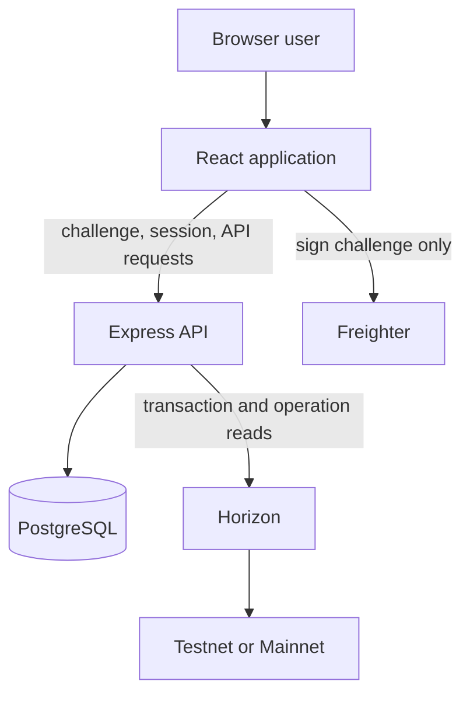

# Architecture

AidTrace is a single web application with a React/Vite frontend, an Express API, PostgreSQL persistence, and read-only Stellar Horizon lookups. The repository does not include a Soroban contract.

## Boundaries

- `src/` renders the UI and calls the API. Freighter signs an authentication challenge; the app does not ask for secret keys or submit transactions.
- `server/auth.ts` implements challenge, signature verification, session, CSRF, Origin, and logout behavior.
- `server/records.ts` implements public/beneficiary/admin routes, role checks, record mutation, pagination, rate limits, and audit writes.
- `server/stellar-verification.ts` reads Horizon transaction and operation data and compares the record fields with a payment operation.
- `server/db.ts` owns the PostgreSQL pool and transactions. `migrations/` defines the schema; `scripts/` runs migrations and the initial admin seed.

## Data flow

Wallet authentication creates a five-minute, single-use challenge. The wallet signs the challenge message and the server verifies the signature before storing hashed session/CSRF tokens. Each protected request resolves the current wallet role from PostgreSQL. Mutations require an allowed origin and session-bound CSRF token.

Verification uses the selected network's Horizon endpoint. AidTrace stores the check result and history; the source, destination, amount, asset, and issuer must match on a single payment-like operation. Verification does not prove who controlled the recipient wallet or what happened after payment.

Public record responses use a separate projection. Without recipient consent, AidTrace replaces the recipient name with a stable HMAC-derived pseudonym and withholds the wallet, transaction hash, note, and selected verification details. The HMAC key is `PSEUDONYM_SECRET`, independent from `SESSION_SECRET`.

## Deployment shape

The development frontend uses Vite's `/api` proxy to the API. Production can serve static Vite assets and the API separately, but a same-origin reverse proxy is preferred so the Secure, HttpOnly, SameSite=Lax session cookie works consistently. See [deployment](deployment.md) for environment and operations guidance.
