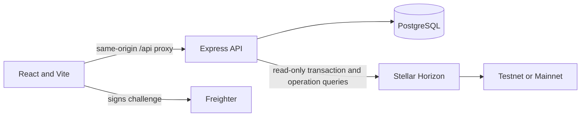

# AidTrace Backend Design

This document describes the backend currently in this repository. Implemented behavior is distinguished from operational requirements that have not been verified. AidTrace uses PostgreSQL, an Express API, and read-only Stellar Horizon requests. The repository does not include a Soroban contract.

## Architecture

The frontend is in `src/`. `server/app.ts` composes CORS, JSON parsing, the auth router, record routes, health check, and error handlers. `server/auth.ts` implements wallet challenge authentication, sessions, CSRF, and session revocation. `server/records.ts` implements aid records, public and beneficiary views, role administration, audit queries, pagination, and rate limits. `server/stellar-verification.ts` queries Horizon. `server/db.ts` owns the PostgreSQL pool and transaction helper. SQL migrations are in `migrations/`; the migration and admin seed commands are in `scripts/`.

The Vite development server listens on port 5173 and proxies `/api` to port 3001 by default. `API_PROXY_TARGET` changes the proxy destination for container networking. Production can host the Vite assets separately from Express, but a same-origin HTTPS reverse proxy is preferred for the session cookie.

## Data Model

All application tables use PostgreSQL. Migration `001_initial_schema.sql` creates the tables and indexes below. The migration runner separately creates `schema_migrations` to track applied files. Migration `002_unique_network_tx_hash.sql` normalizes transaction hashes and adds the unique network/hash constraint. No foreign key declares `ON DELETE CASCADE`; PostgreSQL's default referential behavior applies.

### `schema_migrations`

Created by `scripts/migrate.ts` before application migrations.

| Column       | Type          | Constraint/default       |
| ------------ | ------------- | ------------------------ |
| `version`    | `TEXT`        | Primary key              |
| `applied_at` | `TIMESTAMPTZ` | `NOT NULL DEFAULT NOW()` |

Indexes: primary-key index on `version`.

### `users`

| Column                  | Type          | Constraint/default       |
| ----------------------- | ------------- | ------------------------ |
| `wallet_address`        | `TEXT`        | Primary key              |
| `created_at`            | `TIMESTAMPTZ` | `NOT NULL DEFAULT NOW()` |
| `last_authenticated_at` | `TIMESTAMPTZ` | Nullable                 |

Indexes: primary-key index on `wallet_address`.

### `wallet_roles`

| Column           | Type          | Constraint/default                                                   |
| ---------------- | ------------- | -------------------------------------------------------------------- |
| `wallet_address` | `TEXT`        | Primary key; foreign key to `users.wallet_address`                   |
| `role`           | `TEXT`        | `NOT NULL`; check in `donor`, `organization`, `beneficiary`, `admin` |
| `updated_by`     | `TEXT`        | `NOT NULL`; foreign key to `users.wallet_address`                    |
| `updated_at`     | `TIMESTAMPTZ` | `NOT NULL DEFAULT NOW()`                                             |

Wallets without a row are treated as donors. Index: `wallet_roles_role_wallet_idx(role, wallet_address)`.

### `organizations`

| Column            | Type          | Constraint/default                                 |
| ----------------- | ------------- | -------------------------------------------------- |
| `wallet_address`  | `TEXT`        | Primary key; foreign key to `users.wallet_address` |
| `display_name`    | `TEXT`        | `NOT NULL`                                         |
| `normalized_name` | `TEXT`        | `NOT NULL UNIQUE`                                  |
| `created_at`      | `TIMESTAMPTZ` | `NOT NULL DEFAULT NOW()`                           |
| `updated_at`      | `TIMESTAMPTZ` | `NOT NULL DEFAULT NOW()`                           |

The wallet address is the organization's account used by payment-source verification. The primary-key and unique constraints provide indexes on `wallet_address` and `normalized_name`.

### `sessions`

| Column            | Type          | Constraint/default                                         |
| ----------------- | ------------- | ---------------------------------------------------------- |
| `session_hash`    | `TEXT`        | Primary key; stores the token digest, not the cookie token |
| `wallet_address`  | `TEXT`        | `NOT NULL`; foreign key to `users.wallet_address`          |
| `network`         | `TEXT`        | `NOT NULL`; check in `testnet`, `mainnet`                  |
| `csrf_token_hash` | `TEXT`        | `NOT NULL`                                                 |
| `created_at`      | `TIMESTAMPTZ` | `NOT NULL DEFAULT NOW()`                                   |
| `expires_at`      | `TIMESTAMPTZ` | `NOT NULL`                                                 |
| `revoked_at`      | `TIMESTAMPTZ` | Nullable                                                   |
| `last_seen_at`    | `TIMESTAMPTZ` | Nullable; not currently updated by request handling        |

Indexes: `sessions_wallet_expiry_idx(wallet_address, revoked_at, expires_at)` and partial `sessions_expiry_idx(expires_at) WHERE revoked_at IS NULL`, plus the primary key.

### `challenges`

| Column           | Type          | Constraint/default                                |
| ---------------- | ------------- | ------------------------------------------------- |
| `challenge_id`   | `TEXT`        | Primary key                                       |
| `nonce`          | `TEXT`        | `NOT NULL UNIQUE`                                 |
| `wallet_address` | `TEXT`        | `NOT NULL`; foreign key to `users.wallet_address` |
| `network`        | `TEXT`        | `NOT NULL`; check in `testnet`, `mainnet`         |
| `signed_message` | `TEXT`        | `NOT NULL`                                        |
| `created_at`     | `TIMESTAMPTZ` | `NOT NULL DEFAULT NOW()`                          |
| `expires_at`     | `TIMESTAMPTZ` | `NOT NULL`                                        |
| `used_at`        | `TIMESTAMPTZ` | Nullable                                          |

Indexes: `challenges_wallet_expiry_idx(wallet_address, expires_at, used_at)`, the primary key, and the unique nonce index.

### `aid_records`

| Column                | Type          | Constraint/default                                                                          |
| --------------------- | ------------- | ------------------------------------------------------------------------------------------- |
| `id`                  | `TEXT`        | Primary key                                                                                 |
| `organization_wallet` | `TEXT`        | `NOT NULL`; foreign key to `organizations.wallet_address`                                   |
| `recipient_name`      | `TEXT`        | `NOT NULL`                                                                                  |
| `recipient_wallet`    | `TEXT`        | `NOT NULL`; validated by the API, no foreign key                                            |
| `purpose`             | `TEXT`        | `NOT NULL`                                                                                  |
| `amount_stroops`      | `BIGINT`      | `NOT NULL CHECK (amount_stroops > 0)`                                                       |
| `asset_code`          | `TEXT`        | `NOT NULL`                                                                                  |
| `asset_issuer`        | `TEXT`        | Nullable                                                                                    |
| `network`             | `TEXT`        | `NOT NULL`; check in `testnet`, `mainnet`                                                   |
| `tx_hash`             | `TEXT`        | Nullable; unique with `network` after migration 002                                         |
| `disbursement_date`   | `DATE`        | `NOT NULL`                                                                                  |
| `note`                | `TEXT`        | `NOT NULL DEFAULT ''`                                                                       |
| `recipient_consent`   | `BOOLEAN`     | `NOT NULL DEFAULT FALSE`                                                                    |
| `status`              | `TEXT`        | `NOT NULL`; check in `verified`, `mismatch`, `not-found`, `unverified`, `pending`, `voided` |
| `created_by`          | `TEXT`        | `NOT NULL`; foreign key to `users.wallet_address`                                           |
| `created_at`          | `TIMESTAMPTZ` | `NOT NULL DEFAULT NOW()`                                                                    |
| `updated_at`          | `TIMESTAMPTZ` | Nullable                                                                                    |
| `void_reason`         | `TEXT`        | Nullable                                                                                    |
| `voided_by`           | `TEXT`        | Nullable; foreign key to `users.wallet_address`                                             |
| `voided_at`           | `TIMESTAMPTZ` | Nullable                                                                                    |

The void-field check requires `void_reason`, `voided_by`, and `voided_at` to be either all NULL or all populated. Migration 002 converts blank hashes to NULL, lowercases nonblank hashes, and adds `UNIQUE (network, tx_hash)`; PostgreSQL permits multiple NULLs under this unique constraint. Its preflight groups case-insensitively by network/hash and aborts with the duplicate rows if conflicts exist.

Indexes: `aid_records_created_idx(created_at DESC, id DESC)`, `aid_records_organization_created_idx(organization_wallet, created_at DESC, id DESC)`, `aid_records_recipient_created_idx(recipient_wallet, created_at DESC, id DESC)`, `aid_records_network_status_date_idx(network, status, disbursement_date, id)`, the primary key, and the migration-002 unique index on `(network, tx_hash)`.

### `verification_results`

| Column                   | Type          | Constraint/default                                                                |
| ------------------------ | ------------- | --------------------------------------------------------------------------------- |
| `id`                     | `TEXT`        | Primary key                                                                       |
| `aid_record_id`          | `TEXT`        | `NOT NULL`; foreign key to `aid_records.id`                                       |
| `status`                 | `TEXT`        | `NOT NULL`; check in `verified`, `mismatch`, `not-found`, `unverified`, `pending` |
| `differences_json`       | `JSONB`       | `NOT NULL DEFAULT '[]'::jsonb`                                                    |
| `reason`                 | `TEXT`        | Nullable                                                                          |
| `ledger`                 | `BIGINT`      | Nullable                                                                          |
| `transaction_created_at` | `TIMESTAMPTZ` | Nullable                                                                          |
| `source_account`         | `TEXT`        | Nullable                                                                          |
| `destination`            | `TEXT`        | Nullable                                                                          |
| `amount_stroops`         | `BIGINT`      | Nullable                                                                          |
| `asset_code`             | `TEXT`        | Nullable                                                                          |
| `asset_issuer`           | `TEXT`        | Nullable                                                                          |
| `checked_at`             | `TIMESTAMPTZ` | `NOT NULL DEFAULT NOW()`                                                          |
| `cache_expires_at`       | `TIMESTAMPTZ` | Nullable                                                                          |

Indexes: `verification_record_checked_idx(aid_record_id, checked_at DESC, id DESC)`, `verification_status_checked_idx(status, checked_at DESC)`, and the primary key.

### `rate_limits`

| Column          | Type          | Constraint/default                                       |
| --------------- | ------------- | -------------------------------------------------------- |
| `key_hash`      | `TEXT`        | Part of composite primary key `(key_hash, window_start)` |
| `window_start`  | `TIMESTAMPTZ` | Part of composite primary key                            |
| `request_count` | `INTEGER`     | `NOT NULL CHECK (request_count >= 0)`                    |
| `expires_at`    | `TIMESTAMPTZ` | `NOT NULL`                                               |

Index: `rate_limits_expiry_idx(expires_at)`. The application stores digests of rate-limit keys, not raw wallet-derived keys.

### `audit_events`

| Column           | Type          | Constraint/default                              |
| ---------------- | ------------- | ----------------------------------------------- |
| `id`             | `TEXT`        | Primary key                                     |
| `action`         | `TEXT`        | `NOT NULL`                                      |
| `actor_wallet`   | `TEXT`        | Nullable; foreign key to `users.wallet_address` |
| `subject_wallet` | `TEXT`        | Nullable; foreign key to `users.wallet_address` |
| `record_id`      | `TEXT`        | Nullable; foreign key to `aid_records.id`       |
| `summary`        | `TEXT`        | `NOT NULL`                                      |
| `metadata_json`  | `JSONB`       | `NOT NULL DEFAULT '{}'::jsonb`                  |
| `created_at`     | `TIMESTAMPTZ` | `NOT NULL DEFAULT NOW()`                        |

Indexes: `audit_events_created_idx(created_at DESC, id DESC)`, `audit_events_actor_created_idx(actor_wallet, created_at DESC, id DESC)`, `audit_events_record_created_idx(record_id, created_at DESC, id DESC)`, `audit_events_action_created_idx(action, created_at DESC, id DESC)`, and the primary key. The migrations do not enforce database-level append-only permissions.

## API Routes

All handlers use `Cache-Control: no-store`; errors generally return `{ "error": "..." }`. The `Origin` allowlist comes from `CORS_ALLOWED_ORIGINS` (defaulting to `PUBLIC_APP_ORIGIN`). Protected writes require a valid session, allowed Origin, session-bound CSRF token, and applicable role. The API does not expose a database-readiness health route.

| Method and path                    | Access                                                   | Behavior and filters                                                                                                                                                 |
| ---------------------------------- | -------------------------------------------------------- | -------------------------------------------------------------------------------------------------------------------------------------------------------------------- |
| `GET /api/_healthcheck`            | Public                                                   | Process liveness response `{ok:true,service:"aidtrace-wallet-api"}`; does not query PostgreSQL.                                                                      |
| `POST /api/auth/challenge`         | Public, allowed Origin                                   | Body `{address, network}`; validates a Stellar public key and `testnet`/`mainnet`, creates a five-minute challenge; limit 8 per 15 minutes per wallet.               |
| `POST /api/auth/verify`            | Public, allowed Origin                                   | Body `{challengeId,address,network,signature}`; validates and consumes challenge, verifies signature, creates session cookie; limit 12 per minute per wallet.        |
| `GET /api/me`                      | Optional session                                         | Returns `{session:null}` or current wallet/network/role/CSRF token/expiry. Invalid or absent session clears the cookie.                                              |
| `POST /api/auth/logout`            | Optional session, allowed Origin; CSRF if session exists | Body includes `csrfToken` when signed in; revokes current session and clears cookie.                                                                                 |
| `POST /api/auth/logout-everywhere` | Any authenticated role, allowed Origin + CSRF            | Revokes all active sessions for the current wallet and clears cookie.                                                                                                |
| `GET /api/transparency`            | Public; optional session affects private projection      | Filters: `q`, `organization`, `asset`, `network`, `status`, `from`, `to`, `limit`, `cursor`; returns records, facets, status/asset summary, and pagination metadata. |
| `GET /api/beneficiary`             | Beneficiary or admin                                     | Same record filters/pagination, always SQL-scoped to the session wallet's recipient address.                                                                         |
| `POST /api/records`                | Organization or admin, Origin + CSRF                     | Validates and creates record; begins verification, returns `201 {record}`. Writes limited to 60/minute per wallet.                                                   |
| `PUT /api/records/:id`             | Owning organization or admin, Origin + CSRF              | Validates and updates a non-voided record; re-verifies and returns `{record}`.                                                                                       |
| `POST /api/records/:id/void`       | Owning organization or admin, Origin + CSRF              | Body `{csrfToken,reason}`; reason must be at least five characters; stores actor/time/reason without deleting record.                                                |
| `POST /api/records/:id/verify`     | Any authenticated role, Origin + CSRF                    | Rechecks record unless a latest verified/mismatch result is still cached; limit 30/minute per wallet.                                                                |
| `GET /api/admin/roles`             | Admin                                                    | Filters `role`, `q`, `limit`, `cursor`; returns roles and pagination metadata.                                                                                       |
| `POST /api/admin/roles`            | Admin, Origin + CSRF                                     | Body `{csrfToken,address,role}`; assigns role and creates organization metadata for organization role. Prevents self-demotion.                                       |
| `DELETE /api/admin/roles/:address` | Admin, Origin + CSRF                                     | CSRF token in JSON body; removes explicit role, reverting wallet to donor; prevents self-removal.                                                                    |
| `GET /api/audit`                   | Admin                                                    | Filters `action`, `address`, `recordId`, `q`, `limit`, `cursor`; returns paginated audit entries.                                                                    |

List limit defaults to 20 and must be an integer from 1 to 100. Cursors are signed with `SESSION_SECRET`, versioned, and bound to normalized query filters. A page response includes `nextCursor` and `hasMore` in JSON; when another page exists it also includes `X-Next-Cursor`, `X-Has-More`, and `Link` headers. Credentialed CORS exposes those headers.

## Wallet Authentication Flow

1. The client requests a public address/network from Freighter; AidTrace never requests a seed phrase or private key and does not submit a payment.
2. `POST /api/auth/challenge` checks the allowed Origin and validates the address/network. It creates a 24-byte random challenge ID and 32-byte random nonce, stores the exact message and expiry, and returns expiry as milliseconds. The signed message includes the configured origin, address, network, nonce, issuance time, five-minute expiry, and the purpose statement.
3. Freighter signs the exact UTF-8 message. The server verifies `SHA-256(UTF-8("Stellar Signed Message:\\n" + message))` with Ed25519 verification from `@stellar/stellar-sdk` and the public key. Signatures may be valid 64-byte hex or canonical base64.
4. The server conditionally consumes the challenge in a PostgreSQL transaction, resolves the current wallet role, stores a SHA-256 digest of a random 32-byte session token, stores a digest of a session-derived CSRF token, and writes a wallet-authenticated audit event. Replay returns 409; missing, expired, mismatched, or invalid challenges/signatures return 401.
5. The cookie is `aidtrace_session`, HttpOnly, Secure, SameSite=Lax, path `/`, seven-day max age. Every authenticated request reloads active, unexpired session and current role from PostgreSQL. `GET /api/me` also returns the CSRF token to the authenticated client.
6. State-changing routes check Origin and constant-time comparison of the supplied CSRF token's digest. Logout revokes one session; logout-everywhere revokes every active session for the wallet. Both clear the cookie and audit revocation.

`SESSION_SECRET` must be at least 32 bytes. It keys the CSRF derivation and cursor signatures. `PSEUDONYM_SECRET` is a separate HMAC key for consent-off beneficiary labels; it must be at least 32 bytes, and production does not accept a missing key or the example placeholder. Only `NODE_ENV=development` with no configured key uses the explicitly named development fallback.

## Stellar Verification Rules

`checkTransaction` uses the selected network's configured Horizon base URL, defaults to public Testnet/Mainnet Horizon endpoints, uses a 10-second request timeout, and performs read-only GET requests. It first checks transaction success, then reads operations in ascending pages of 200 with a 20-page bound.

Eligible operation types are `payment`, `create_account`, `path_payment_strict_receive`, and `path_payment_strict_send`. One operation must match all of: source organization wallet, recipient wallet, exact amount in stroops, asset code, and issuer. Path strict-send uses destination amount/asset fields. Create-account uses account, starting balance, native XLM, and funder/source. Fields from separate operations are never combined. Reaching the operation page bound without a complete read yields `pending`.

| Status       | Implemented meaning                                                                                                                         |
| ------------ | ------------------------------------------------------------------------------------------------------------------------------------------- |
| `verified`   | Successful transaction has one operation matching all checked record fields.                                                                |
| `mismatch`   | Transaction is unsuccessful or no eligible operation fully matches; differences are recorded.                                               |
| `not-found`  | Horizon returns 404 for the hash on the selected network.                                                                                   |
| `unverified` | No transaction hash was supplied.                                                                                                           |
| `pending`    | Horizon is unavailable/unreadable, success is not confirmed, operation pagination is incomplete/over budget, or the Horizon URL is invalid. |
| `voided`     | Aid-record status set by a void operation; it is not a verification-result status. Void preserves the record and history.                   |

Verified and mismatch results may be cached for one hour. Pending and other statuses do not receive a cache expiry. Verification history is stored in `verification_results`; a later verification updates the record's status unless the record is already voided. `verified` proves only the checked public payment fields, not identity, consent, intended use, or real-world impact.

## Security and Current Gaps

- Roles are enforced on the API. Wallets without an explicit role default to donor. Organizations may change only their own records; admins manage role assignments and audit queries. Beneficiary reads are wallet-scoped in SQL. Admin self-demotion/removal is blocked; last-other-admin protection is not implemented.
- Mutations require allowed Origin and CSRF. CORS uses exact configured origins and credentials; wildcard credentialed CORS is not used. JSON request bodies are strict and limited to 32 KB. Error responses do not include request bodies by design, although unexpected server errors are logged.
- `SESSION_SECRET` and `PSEUDONYM_SECRET` are server-only. Never place either in a `VITE_*` setting, logs, or committed env files. The pseudonym HMAC is domain-separated and derived from the beneficiary wallet; it provides stable pseudonyms, not anonymity.
- Without recipient consent, public transparency replaces the beneficiary name with an HMAC label and withholds recipient wallet, transaction hash, note, and selected verification details. Organization and creator wallet, purpose, amount, and date remain visible. With consent, the public record projection includes the full record.
- Database rate limits are atomic and keyed by digests for challenges (8/15m/address), signature verification (12/min/address), writes (60/min/wallet), and record verification (30/min/wallet). General per-IP and public-read rate limits are not implemented.
- Successful authentication, logout, role change/removal, record create/update/void, and non-cached verification are audited. Challenge attempts, failed auth, admin seeding, and all security rejections are not comprehensively audited. The schema does not enforce append-only access for audit rows.
- SQL values are parameterized. Application validation covers Stellar public keys, networks, hashes, amounts/stroops, assets/issuers, dates, text sizes, roles, list filters, and cursors. The server health route is process liveness only; a database readiness probe is not implemented.

## Deployment Requirements

- Use Node.js 20 or newer and PostgreSQL. The local example uses PostgreSQL on port 5432; CI uses PostgreSQL 16. The project also has Docker API and Compose configuration, but Compose execution is not verified on every machine.
- Set `DATABASE_URL` for the runtime pool. The migration command uses `DATABASE_URL_UNPOOLED` when supplied, otherwise `DATABASE_URL`; use a direct (non-pooled) endpoint for migration where available. Remote connection examples should use `sslmode=verify-full`.
- Configure distinct 32-byte-minimum `SESSION_SECRET` and `PSEUDONYM_SECRET`; exact `PUBLIC_APP_ORIGIN` and `CORS_ALLOWED_ORIGINS`; `PORT`; network-specific Horizon URLs; and optionally `DEFAULT_STELLAR_NETWORK`. Bootstrap the first admin by setting a public Stellar `ADMIN_WALLET` and running `npm run db:seed-admin`; there is no public bootstrap route.
- Integration tests use `TEST_DATABASE_URL` and require `TEST_DATABASE_BRANCH=test`, `TEST_DATABASE_URL_UNPOOLED`, and `PRODUCTION_DATABASE_HOST`. The test setup rejects a test endpoint that matches the production hostname or runtime endpoint. Use Neon dev for local runtime and a separate Neon test branch for integration tests; never target production.
- `npm run db:migrate` applies ordered `NNN_name.sql` migrations and records versions in `schema_migrations`. Migration 002 checks for case-insensitive duplicate hashes before creating the unique index and aborts without applying that migration if duplicates exist.
- For production, serve the built Vite assets behind HTTPS with Express behind the same-origin `/api` proxy where possible. The cookie is Secure and SameSite=Lax. A cross-site deployment requires a separate cookie/CORS review.
- Configure PostgreSQL access restrictions, least-privilege app/migration identities, backup retention, and tested restore procedures before production operation. No production deployment, backup/restore exercise, or browser-level Freighter cookie verification is claimed by this design.

## Verification Evidence

The executable checks are `npm run typecheck`, `npm run lint`, `npm run format:check`, `npm test`, `npm run build`, and the aggregate `npm run check` (typecheck, lint, test, build). The backend tests use Supertest/Vitest and mocked Horizon calls; when `TEST_DATABASE_URL` is configured, database integration tests use the guarded test endpoint. Local Docker Compose, production hosting, browser-level Freighter journeys, and the admin seed require their respective environment/account prerequisites and must not be inferred from unit or API test results.
